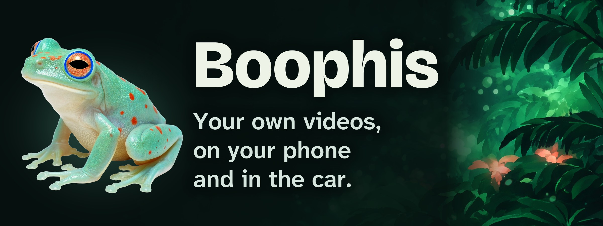
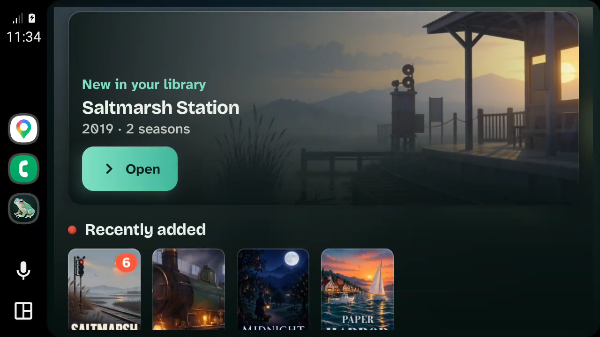
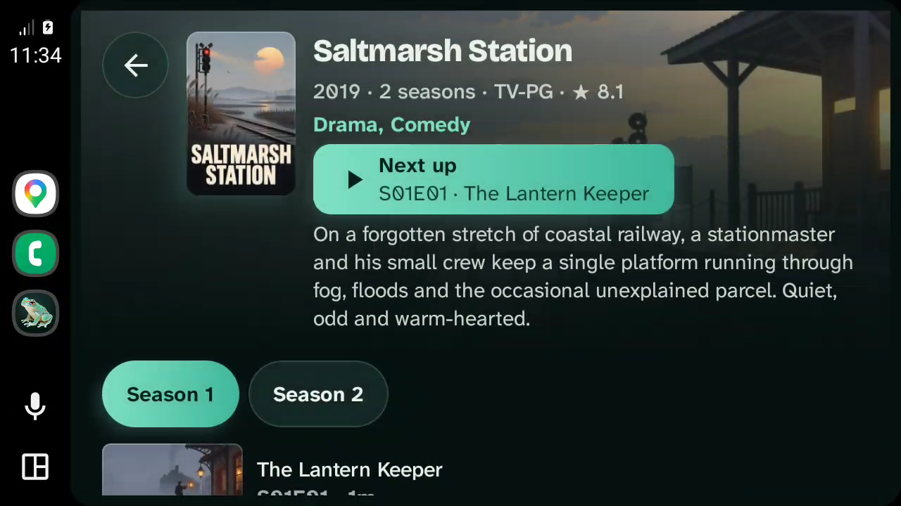
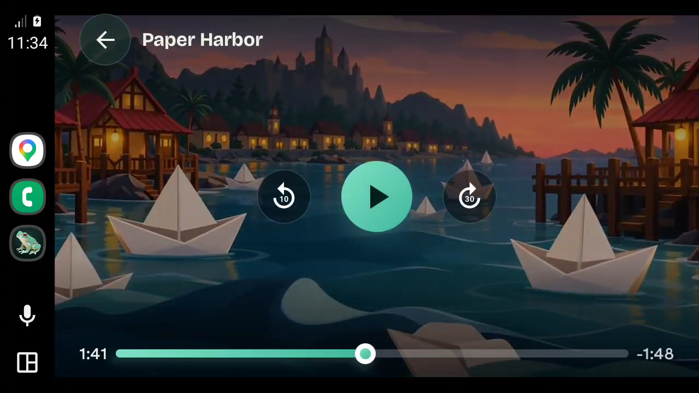
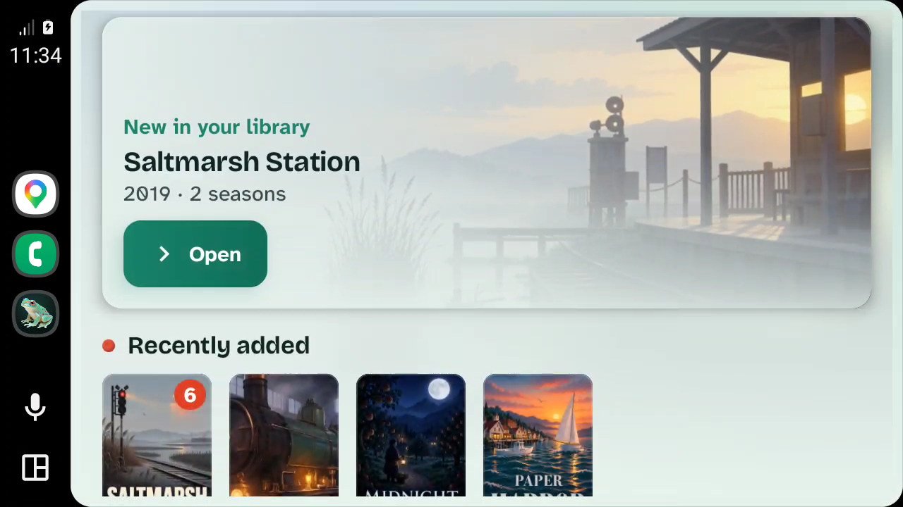
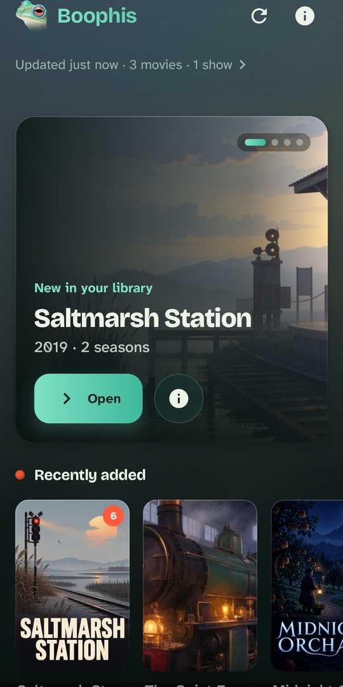
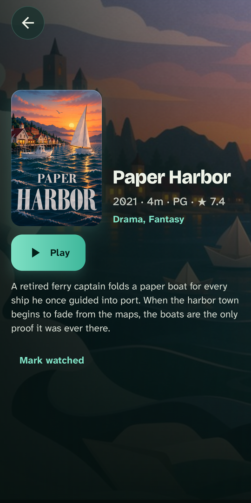
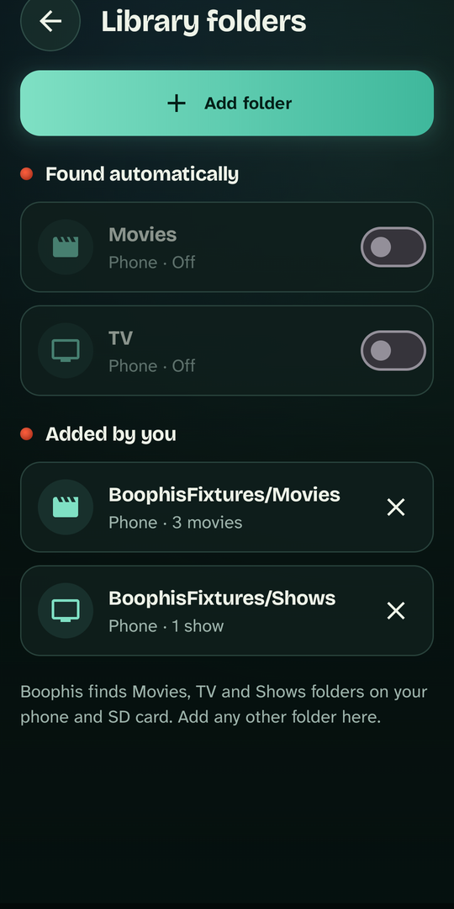

<p align="center">
  
</p>

<p align="center">
  <a href="LICENSE"></a>
  
  
  
  <a href="../../releases/latest"></a>
</p>

Boophis puts the videos on your phone on your car's screen. It runs full screen inside Android
Auto, and when the car connects it opens on what you were watching, ready to resume.

There's no server to set up and nothing to stream. Boophis plays the files stored on your phone or
SD card, draws its own interface on the car's display instead of mirroring your phone, and has no
internet permission, no accounts and no analytics.

It's free software (GPL-3.0-or-later). The name comes from *Boophis*, the bright-eyed tree frogs of
Madagascar.

> [!WARNING]
> **For passengers and parked use only. Never watch video while driving.**
> Boophis has no driving lock, so that passengers and parked drivers can use it. Keeping the screen
> out of the driver's view is your responsibility, and in many places it is illegal for video to be
> visible to the driver of a moving vehicle. See [Safety and liability](#safety-and-liability).

## In the car

<p align="center">
  
  
</p>
<p align="center">
  
  
</p>

Every control is at least 76 dp and works with a tap or a scroll. Swipes act where your finger is.
The steering-wheel keys play, pause and skip. Boophis follows the car's day and night signal, and
the player always uses the night palette.

Boophis draws its own interface on a private virtual display on the car's screen. It doesn't mirror
your phone.

## On the phone

<p align="center">
  
  
  
</p>

- Boophis finds `Movies`, `TV`, `Shows` and `TV Shows` folders at the top of the phone's storage or
  an SD card. You can add any other folder on the *Library folders* screen.
- It reads Jellyfin and Kodi sidecar files: `.nfo`, `poster.jpg`, `fanart.jpg`, `-thumb.jpg` and
  subtitles. Loose, release-named files work too. Their titles get cleaned up, and a well-lit frame
  from the video becomes the poster.
- It has very few settings. It resumes where you stopped, marks a title watched at 92 %, shows Next
  Up, plays the next episode, and picks English audio and forced subtitles.

## Install

1. Download the APK from the [latest release](../../releases/latest) and open it on your phone.
   Allow your browser or file manager to install apps if Android asks.
2. Open Boophis. The *Get ready for the car* checklist has three steps:
   1. *Let Boophis find your videos* turns on Android's *All files access* for Boophis.
   2. *Make Boophis car-ready* reinstalls Boophis through Android's own installer. If Play Protect
      offers a scan, tap **Scan app**.
   3. *Plug in your car.*
3. In the car, tap Boophis in Android Auto's launcher. Android Auto's *Customize launcher* setting
   can move it to the front.

You don't need Android Auto's developer mode or its *Unknown sources* setting.

<details>
<summary>Why the car-ready step?</summary>

Android Auto only lists apps whose install was requested by the phone's stock package installer and
recorded as coming from Google Play. Apps installed any other way (`adb`, a file manager's own
installer, other sideload tools) are hidden in the car without any message.

Boophis hands its own APK back to the system installer with that attribution, the same thing tools
like KingInstaller do. Your library and resume points are kept. This needs the *Install unknown
apps* permission once. [ARCHITECTURE.md](ARCHITECTURE.md) has the details.
</details>

<details>
<summary>Permissions</summary>

| Permission | Why |
|---|---|
| All files access | Read your video folders and the Jellyfin/Kodi sidecar files next to them |
| Install unknown apps | The one-time car-ready reinstall of Boophis itself |
| Notifications, foreground service | Playback controls on the lock screen and in the car |
| Network state | Declared by the Media3 player library; there is no internet permission, so nothing can be sent |
| Phone state, write storage | Declared by Google's Android Auto SDK. Boophis never requests them, so they are never granted |
</details>

## Library layout

```
Movies/Title (Year)/Title (Year).mkv   (+ poster.jpg, fanart.jpg, movie.nfo, Title (Year).en.forced.srt)
Shows/Show Name/tvshow.nfo, poster.jpg, fanart.jpg, season01-poster.jpg
Shows/Show Name/Season 01/Show Name S01E01 - Title.mkv   (+ .nfo, -thumb.jpg)
```

The library refreshes when the app starts, when Android Auto connects, and when you tap **Refresh
library**. The status line on Home shows when it last updated and what it found. Tap it to choose
folders.

## Build

You need JDK 21 and the Android SDK (platform 37, build-tools 37). On Windows with Git Bash:

```sh
. tools/env.sh                   # finds JDK 21 under ~/.jdks and the SDK in %LOCALAPPDATA%
bash tools/fetch-aauto.sh        # fetches Google's Android Auto SDK from Fermata's repository
./gradlew assembleDebug
./gradlew :ui:testDebugUnitTest :core-model:test :core-library:testDebugUnitTest
```

Without Google's Android Auto SDK, Boophis still builds and runs on the phone, but it has no Android
Auto entry. Release builds are signed when `keystore.properties` (`storeFile`, `storePassword`,
`keyAlias`, `keyPassword`) exists in the project root. Never commit it or the keystore. Updates must
be signed with the same key.

<details>
<summary>Modules</summary>

| Module | What |
|---|---|
| `core-model` | Data classes, `MediaLibrary` / `PlayerController` contracts, automation rules (pure Kotlin, tested) |
| `core-library` | Volume and folder scanning, NFO/name/artwork parsing, Room index and watch state |
| `core-player` | Media3 ExoPlayer (+ Jellyfin FFmpeg audio decoder), resume/tracks/auto-next, MediaSession |
| `ui` | Compose screens shared by phone and car (`LayoutMode.Phone` / `Car`) |
| `car` | Surface → VirtualDisplay → Presentation host for the car screen (plus an unregistered Car App Library route) |
| `car-projection` | Android Auto entry point: legacy projection `CarActivity` (Google's SDK) |
| `app` | Application graph, phone activity, car-ready installer, debug-only adb hooks |
</details>

[CONTRIBUTING.md](CONTRIBUTING.md) covers the dev loop (Desktop Head Unit, debug hooks, fixtures) and
the commit rules. [ARCHITECTURE.md](ARCHITECTURE.md) explains how the car screen works and what
Android Auto checks. Test media in `fixtures/` uses invented titles only.

## Safety and liability

Boophis is for passengers, and for watching while the vehicle is parked. The driver must not watch
or operate it while driving.

Android Auto normally blocks video while the car moves. Boophis doesn't check speed, gear or driving
state, so you alone are responsible for where its screen is visible and for following the traffic
laws where you drive.

Boophis isn't affiliated with, endorsed by or supported by Google, Android Auto or any vehicle
maker. Android Auto may change in ways that stop it working.

Boophis is provided "as is", without warranty of any kind. To the extent permitted by law, its
authors and contributors accept no liability for any damage, injury, loss, fine or other
consequence of using it. See sections 15 and 16 of the [GPL-3.0](LICENSE).

## License

GPL-3.0-or-later. See [LICENSE](LICENSE), and [NOTICE.md](NOTICE.md) for third-party code, the
Fermata credit and the proprietary Android Auto SDK used for the car entry point.
